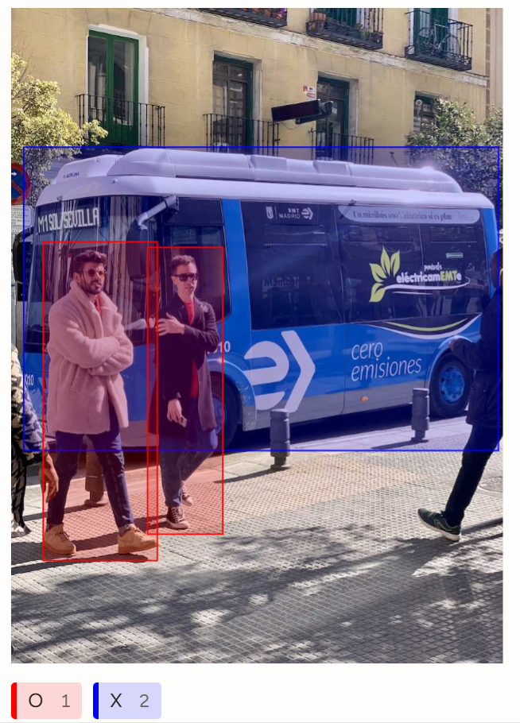

# AutoAudiogram

An automatic audiogram analysis system that detects audiogram symbols, extracts patient information using OCR, and stores the results into a database.

## Features

🎯 Audiogram symbol detection using YOLO26

📝 OCR support

- EasyOCR

- RapidOCR

- PaddleOCR

- PaddleOCR-VL

- HunyuanOCR

👤 Fake patient information generation

💾 SQLite database management

📊 OCR accuracy validation

🌐 Gradio web interface

🖼️ Image preview and PDF upload support

Batch processing and patient examination history with image and data previews.

## Project Structure

```
AutoAudiogram/
│
├── app.py
├── config.yaml
├── db.db
│
├── data/
│
├── models/
│
├── outputs/
│   ├── debug/
│   ├── images/
│   └── ocr/
│
├── scripts/
│   └── ocr/
|
├── src/
│
├── synthetic_dataset/
│   ├── generate.py
│   ├── symbols/
│   ├── images/
│   └── labels/
│
└── README.md
```

## Setup

Install dependencies using [uv](https://docs.astral.sh/uv/getting-started/installation/).

```bash
uv sync
```

## Quick Run

Run the code below and open it on [http://localhost:7860](http://localhost:7860).

```bash
uv run python app.py
```

The web interface has three tabs:

- **Audiogram**: upload and preview one image or PDF, select an OCR model, and view detected symbols, dB values, patient information, and a downloadable CSV.
- **Batch Processing**: upload multiple images or PDFs and process them sequentially with one OCR model. The results table shows each file's status, extracted information, and any raised error. PDF processing uses only the first page.
- **Patient Search**: filter examination history by patient name, gender, or birthdate, then select a case to view its saved audiogram image and detection dataframe. Names support partial matches; gender and birthdate require exact matches. Images are displayed only while their saved files remain available.

# Object Detection

Detection results group symbols into four output classes: `O`, `X`, `[`, and `]`. The mapping is `<` and `[` to `[`, `>` and `]` to `]`, square to `X`, and triangle to `O`.

The detector uses 16 classes: eight symbol types, each with a normal and an `-os` variant. Both variants map to the same output class; `-os` values retain an `(os)` suffix in the dataframe, CSV, and saved database results, for example `60(os)`. When multiple detections map to the same class and frequency, the highest-confidence detection is retained.

Bracket frequency positions are aligned to a nearby `O` or `X` within 35 horizontal and 15 vertical pixels, preferring the smallest vertical distance, then horizontal distance. dB values use the nearest horizontal grid line or midpoint, starting at -10 dB and increasing in 5 dB steps.

## [YOLO26](https://docs.ultralytics.com/models/yolo26/) Usage Example

This section provides simple YOLO26 training and inference examples. For full documentation on these and other modes, see the Predict, Train, Val, and Export docs pages.

Note that the example below is for YOLO26 Detect models for object detection. For additional supported tasks, see the Segment, Classify, OBB, and Pose docs.

```py
from ultralytics import YOLO
# Load a COCO-pretrained YOLO26n model
model = YOLO("yolo26n.pt")
# Train the model on the COCO8 example dataset for 100 epochs
results = model.train(data="coco8.yaml", epochs=100, imgsz=640)
# Run inference with the YOLO26n model on the 'bus.jpg' image
results = model("path/to/bus.jpg")
```

## Data Collection

For the data collection, we use [Label Studio](https://labelstud.io/) for labeling.

1. Install Label Studio:

```bash
pip install label-studio
```

2. Start Label Studio:

```bash
label-studio start
```

3. Open Label Studio at http://localhost:8080.
4. Click Create to create a project and start labeling data.
5. Click Data Import and upload the images that you want to label.
6. Click Labeling Interface in Settings and choose a template for your use case. For example:

```
<View>
  <Image name="image" value="$image"/>
  <RectangleLabels name="label" toName="image">
    <Label value="O" background="red"/>
    <Label value="X" background="blue"/>
  </RectangleLabels>
</View>
```


7. Export data as YOLO with Images.

## Folder Structure

Organize the data as follows:

```
data/
│
├── images/
│   ├── train/
│   │   └── 1.jpg
│   └── val/
│       └── 2.jpg
|
└── labels/
    ├── train/
    │   └── 1.txt
    └── val/
        └── 2.txt
```

The project's `config.yaml` uses these paths and class IDs. Keep the same class ordering in YOLO labels, symbol sprites, and model weights:

```yaml
# Dataset root directory
path: data

# Relative paths to image directories
train: images/train
val: images/val
test:  # optional

nc: 16
names:
  0: "<"
  1: "<-os"
  2: ">"
  3: ">-os"
  4: "O"
  5: "O-os"
  6: "X"
  7: "X-os"
  8: "["
  9: "[-os"
  10: "]"
  11: "]-os"
  12: "□"
  13: "□-os"
  14: "△"
  15: "△-os"
```

## Synthetic Detection Data

Place the 16 RGBA symbol sprites in `synthetic_dataset/symbols/`, named `0.png` through `15.png` using the class IDs above.

```bash
uv run python synthetic_dataset/generate.py --count 120 --min-symbols 8 --max-symbols 16 --os-ratio 0.9
```

The generator draws symbols on randomized grids, including one red/blue overlapping pair per generated image. Defaults are 590 by 630 pixels and seed 42. Both symbol-count limits must be at least two, minimum must not exceed maximum, and `--os-ratio` must be between 0 and 1.

Images and YOLO labels are saved as matching `synth_00000.png` and `synth_00000.txt` files in `synthetic_dataset/images/` and `synthetic_dataset/labels/`. Use `--out PATH` to change the output root. A labeled preview of the first image is saved at `synthetic_dataset/preview_labeled.png`.

Split generated image/label pairs into the `data/images/{train,val}` and `data/labels/{train,val}` directories before training; the generator does not create a train/validation split.

## Running

Train from `models/yolo26l.pt` using `config.yaml` for 80 epochs at image size 640. Weights are saved in `models/yolo26l_detect/weights/`.

```bash
uv run python -m src.yolo
```

Run inference

```bash
uv run python -m src.detect_symbol
```

The inference command uses `input_image_path` and `model_path` configured in `src/detect_symbol.py`.

# OCR

Supported OCR engines. In the Gradio app, choose the OCR model from the dropdown before processing.

- EasyOCR

- RapidOCR

- [PaddleOCR](https://www.paddleocr.ai/latest/en/version3.x/pipeline_usage/OCR.html)

- [PaddleOCR-VL](https://www.paddleocr.ai/latest/en/version3.x/pipeline_usage/PaddleOCR-VL.html)

- [HunyuanOCR](https://github.com/Tencent-Hunyuan/HunyuanOCR)

Image uploads can be PNG, JPG, JPEG, BMP, WEBP, TIF, or TIFF. PDF uploads are also supported; only the first page is converted and processed.

Extracted OCR fields:

- Doctor
- Patient
- Serial Number
- Gender
- Birthdate
- Test Date

## Database

Patient information and audiogram detection results are stored in SQLite.

Tables

- patient
  - patient_name
  - gender
  - birthdate

- patient_case
  - serial_number
  - doctor_name
  - test_date
  - audiogram
  - audiogram_df

`audiogram_df` stores the dataframe returned from `process_audiogram()` as JSON.

Patients are matched by name, birthdate, and gender together. Cases are inserted or updated by serial number. The `audiogram` field stores the input image path, or the rendered first-page image for a PDF; image data is not stored in SQLite.

Initialize or migrate the database without clearing existing records:

```bash
python -c "from scripts.db import init_db; init_db()"
```

Currently, `python -m scripts.db` initializes the database and then deletes all patient and case records.

## Fake Data Generation

Generate fake patient information for OCR evaluation, put your images inside `/data/raw`.

```bash
python -m scripts.add_fake_data
```

Generated fields

- Doctor

- Patient

- Serial Number

- Gender

- Birthdate

- Test Date

## Validation

Evaluate OCR performance by choosing the backend in `/scripts/validate_ocr.py`.

Available model keys:

- rapidocr
- easyocr
- paddleocr
- paddleocrvl
- hunyuanocr

```bash
python -m scripts.validate_ocr
```
